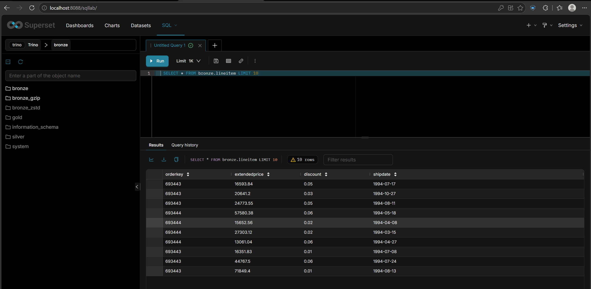

# Отчёт по практической №1 (вариант 1, Q3 «Shipping Priority»)

## 1. Вариант и масштаб

| Поле | Значение |
|---|---|
| ФИО (как в VK Education) | Закарян Эмма Гариковна |
| Вариант (запрос) | Q3 |
| Масштаб `sfN` | sf1 |
| Почему выбрал такой масштаб | sf1 даёт около 7,65 млн строк в трёх нужных таблицах (lineitem ≈ 6 млн). Этого хватает, чтобы заметить разницу между кодеками и эффект фильтров, а весь стек работает на ноутбуке с Docker и запросы идут доли секунды. Больший масштаб потребовал бы заметно больше памяти и диска без нового знания. Один и тот же sf1 на всех слоях. |

## 2. Поднятые сервисы

| Сервис | Роль | Почему именно он |
|---|---|---|
| MinIO | S3-хранилище, сюда падают parquet-файлы | Открытый код, S3-API, поэтому любой движок работает с ним как с AWS S3; поднимается одним контейнером. Замечание: официальные образы MinIO сняты с Docker Hub и закрыты на quay.io, поэтому использован неизменённый образ-зеркало последнего официального релиза `scnd/minio-mirror:RELEASE.2025-09-07T16-13-09Z`. |
| PostgreSQL 16 | БД метаданных Lakekeeper | Открытая и надёжная; Lakekeeper поддерживает её из коробки. Хранит только каталог (таблицы, снапшоты), не данные. |
| Lakekeeper | Iceberg REST Catalog | Реализует открытый REST-протокол Iceberg, поэтому каталог не привязан к одному движку (Trino, Spark, Doris подключаются одинаково). Легче Hive Metastore. |
| Trino | SQL-движок | Читает/пишет Iceberg, есть встроенный коннектор `tpch`, быстрый MPP, поддерживает schema evolution и time travel в Iceberg. |
| Apache Superset | BI поверх lakehouse (п. 6.2) | Открытый код, подключается к Trino через SQLAlchemy, SQL Lab сразу показывает таблицы Bronze. |

### Скрипты

Файлы лежат в репозитории: `docker-compose.yml` (MinIO, PostgreSQL, Lakekeeper, Trino), `docker-compose.superset.yml` + `Dockerfile.superset` (Superset), каталоги Trino в `trino/catalog/`.

```bash
docker compose up -d                                   # поднять основной стек
docker compose ps -a                                   # проверка (lakekeeper-migrate: Exited 0 — это нормально)
docker compose -f docker-compose.yml -f docker-compose.superset.yml up -d --build superset
```

Ручные шаги после запуска:
1. MinIO (http://localhost:9001): создан бакет `lakehouse`.
2. Lakekeeper (http://localhost:8181/ui): bootstrap и warehouse `lakehouse`, тип S3 Compatible, endpoint `http://minio:9000`, region `local`, статические ключи MinIO. Vended credentials и Remote signing выключены (Trino использует собственные ключи из `lakehouse.properties`). Проверка Storage Validation пройдена (все проверки passed).
3. `docker compose restart trino`.

Каталог Trino `lakehouse.properties`: `connector.name=iceberg`, `iceberg.catalog.type=rest`, `iceberg.rest-catalog.uri=http://lakekeeper:8181/catalog`, `iceberg.rest-catalog.warehouse=lakehouse`, формат PARQUET, кодек по умолчанию ZSTD, нативный S3 с path-style доступом к `http://minio:9000`.

## 3. Разбор запроса

| Таблица | Нужные колонки | Что делает запрос |
|---|---|---|
| customer | `custkey`, `mktsegment` | фильтр `mktsegment = 'BUILDING'`; ключ джойна с orders |
| orders | `orderkey`, `custkey`, `orderdate`, `shippriority` | фильтр `orderdate < 1995-03-15`; джойн с customer и lineitem; выводятся и входят в GROUP BY |
| lineitem | `orderkey`, `extendedprice`, `discount`, `shipdate` | фильтр `shipdate > 1995-03-15`; джойн по orderkey; агрегат `sum(extendedprice * (1 - discount))` |

Остальные колонки запросу не нужны, поэтому в Bronze они не копировались.

## 4. Медальон

Каталог `lakehouse`, схемы `bronze`, `silver`, `gold`. Скрипты: `sql/01_bronze.sql`, `02_silver.sql`, `03_gold.sql`.

### Bronze (сырой)

| Таблица | Колонки | Строк | Вес, МБ | Формат | Сжатие | Партиц. | Обоснование |
|---|---|---|---|---|---|---|---|
| bronze.customer | custkey, mktsegment | 150 000 | 0,23 | PARQUET | ZSTD | нет | Сырой слой без бизнес-фильтров. Parquet колоночный, читаются только нужные поля. ZSTD быстро распаковывается и хорошо сжимает (см. п. 5). Таблица крошечная, партиции дали бы лишние мелкие файлы. |
| bronze.orders | orderkey, custkey, orderdate, shippriority | 1 500 000 | 6,66 | PARQUET | ZSTD | нет | Bronze читается целиком при перестроении Silver, партиционирование выгоды не даёт. |
| bronze.lineitem | orderkey, extendedprice, discount, shipdate | 6 001 215 | 38,54 | PARQUET | ZSTD | нет | Самая большая таблица, сжатие здесь важнее всего. На sf1 это несколько файлов, партиции избыточны. |

### Silver (очищенный)

| Таблица | Колонки | Строк | Вес, МБ | Формат | Сжатие | Партиц. | Обоснование |
|---|---|---|---|---|---|---|---|
| silver.order_lines | orderkey, orderdate, shippriority, extendedprice, discount, shipdate | 30 519 | 0,248 (2 файла) | PARQUET | ZSTD | `year(orderdate)` (2 партиции: 1994 — 4 832 строки, 1995 — 25 687) | Факт «строки заказов»: джойн трёх таблиц и фильтры по сегменту и датам уже применены, поэтому данных в 200 раз меньше, чем в lineitem. Партиция по году показана как приём. На 30 тысячах строк выгоды почти нет, но при росте данных (sf100+) фильтр по `orderdate` начнёт отсекать лишние файлы. Год выбран вместо месяца и дня, чтобы не плодить мелкие файлы. |

### Gold (витрина)

| Таблица | Колонки | Строк | Вес, МБ | Формат | Сжатие | Партиц. | Обоснование |
|---|---|---|---|---|---|---|---|
| gold.shipping_priority_top10 | orderkey, revenue, orderdate, shippriority | 10 | 0,001 (1 файл) | PARQUET | ZSTD | нет | Итоговый ответ на Q3, 10 строк. Партиционирование не имеет смысла. Единый формат на всех слоях упрощает работу BI. |

Результат Gold совпал с исходным запросом на `tpch.sf1` (проверка `EXCEPT` в `sql/04_check.sql` вернула 0 строк):

| orderkey | revenue | orderdate | shippriority |
|---|---|---|---|
| 2456423 | 406181.0111 | 1995-03-05 | 0 |
| 3459808 | 405838.6989 | 1995-03-04 | 0 |
| 492164 | 390324.061 | 1995-02-19 | 0 |
| 1188320 | 384537.9359 | 1995-03-09 | 0 |
| 2435712 | 378673.0558 | 1995-02-26 | 0 |
| 4878020 | 378376.7952 | 1995-03-12 | 0 |
| 5521732 | 375153.9215 | 1995-03-13 | 0 |
| 2628192 | 373133.3094 | 1995-02-22 | 0 |
| 993600 | 371407.4595 | 1995-03-05 | 0 |
| 2300070 | 367371.1452 | 1995-03-13 | 0 |

## 5. Тесты производительности

Две копии Bronze (`bronze_gzip`, `bronze_zstd`) созданы скриптом `sql/06_compress.sql`. В используемой версии Trino кодек задаётся табличным свойством `compression_codec` в `CREATE TABLE ... WITH (...)` (сессионное свойство в новых версиях удалено), значение по умолчанию берётся из `iceberg.compression-codec` в каталоге. Запрос Q3 по Bronze выполнялся по 5 раз на каждую копию, время из `system.runtime.queries`.

| Сжатие на Bronze | Время запроса | Размер Bronze, МБ | Вывод |
|---|---|---|---|
| GZIP | 748 / 684 / 652 / 668 / 610 мс, медиана **668 мс** | 45,72 | Размер почти такой же, но запрос медленнее: распаковка GZIP требует больше CPU. |
| ZSTD | 573 / 485 / 473 / 460 / 461 мс, медиана **473 мс** | 45,40 | Лучше: чуть меньше места и примерно на 30 % быстрее. Выбран для всех слоёв. |

Оговорки: первый прогон каждой серии самый медленный (прогрев), поэтому сравнивается медиана. GZIP запускался первым, так что часть разницы могла дать прогрев системы. Разница в размере всего около 0,7 %, основной выигрыш ZSTD именно в скорости. Объём небольшой (sf1, один узел), на больших данных результат нужно проверять заново.

## 6. Часть 2

### 6.1. Понять и объяснить

| Вопрос | Ответ |
|---|---|
| Зачем нужны большие данные и lakehouse? | Данных стало слишком много, и они разные: таблицы, логи, события. В одной обычной базе их хранить дорого и неудобно, а классическое хранилище привязано к одному движку. В lakehouse файлы лежат в дешёвом объектном хранилище (у меня MinIO) в открытом формате Parquet, а Iceberg добавляет к ним таблицы, транзакции, изменение схемы и откат к прошлой версии. Хранение отделено от вычислений, поэтому с одними и теми же данными могут работать разные инструменты (у меня Trino и Superset) и не нужно копировать данные из системы в систему. |
| Schema evolution на Silver | На копии `silver.order_lines_demo` (30 519 строк) выполнено: `ADD COLUMN revenue double` + `UPDATE` (заполнено для всех строк), затем `RENAME COLUMN shippriority TO ship_priority`. После этого старые данные читаются под новыми именами без потерь. Iceberg ведёт колонки по внутренним ID, а не по именам, поэтому `ALTER` меняет только метаданные и не переписывает файлы. Скрипт: `sql/08_evolution.sql`. |
| Time travel и восстановление | Снапшот до удаления `933142705376780523`. «Случайно» удалено 4 832 строки за 1994 год (осталось 25 687). Чтение `FOR VERSION AS OF` показало 30 519 строк, после `CALL lakehouse.system.rollback_to_snapshot('silver','order_lines_demo', <id>)` таблица вернулась к 30 519 строкам. Скрипты: `sql/09`–`sql/11`. |

Скрипт восстановления:

```sql
SELECT max_by(snapshot_id, committed_at) FROM lakehouse.silver."order_lines_demo$snapshots";
DELETE FROM lakehouse.silver.order_lines_demo WHERE year(orderdate) = 1994;
SELECT count(*) FROM lakehouse.silver.order_lines_demo FOR VERSION AS OF <snapshot_id>;
CALL lakehouse.system.rollback_to_snapshot('silver', 'order_lines_demo', <snapshot_id>);
```

### 6.2. Инструмент

| Инструмент | Почему |
|---|---|
| Apache Superset | Открытый код, готовый драйвер для Trino, SQL Lab сразу показывает схемы и таблицы lakehouse, позже по Gold можно строить дашборд. Движки (Doris, StarRocks, Spark) для моей задачи избыточны: Trino уже есть и справляется на sf1. |

Развёртывание: `Dockerfile.superset` (образ `apache/superset` с драйвером `trino`) и `docker-compose.superset.yml` (порт 8088, том для данных). Инициализация:

```bash
docker exec -it lakehouse-p1-superset-1 superset db upgrade
docker exec -it lakehouse-p1-superset-1 superset fab create-admin --username admin ...
docker exec -it lakehouse-p1-superset-1 superset init
```

Действия в UI: Settings → Database Connections → + Database → Trino, SQLAlchemy URI `trino://admin@trino:8080/lakehouse`, Test Connection → Connect. В SQL Lab выполнен запрос `SELECT * FROM bronze.lineitem LIMIT 10`, вернулось 10 строк:



## 7. Выводы

Медальон позволяет не терять исходные данные и при этом получать готовый результат: Bronze хранит почти сырое, Silver очищает и сильно сокращает данные (из 6 млн строк lineitem осталось около 30 тысяч), Gold отдаёт итог на 10 строк. В моём тесте ZSTD оказался быстрее GZIP примерно на 30 % (473 против 668 мс) при почти таком же размере, поэтому я оставила его на всех слоях. Партиционирование по году в Silver на таком объёме почти ничего не даёт, но при большем объёме оно начнёт пропускать ненужные файлы. Самым полезным было увидеть, как Iceberg возвращает таблицу к снапшоту после удаления данных. Самым неожиданным оказалось то, что образ MinIO убрали из публичных реестров и пришлось искать зеркало.
